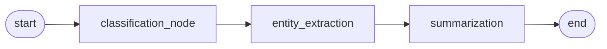
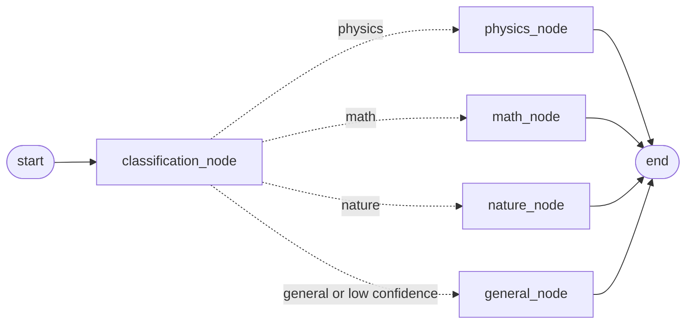
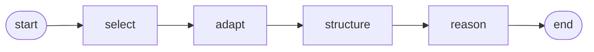

# LangGraph Workflows

A small, hands-on collection of **agentic workflows built with [LangGraph](https://langchain-ai.github.io/langgraph/)** and [Groq](https://groq.com/)-hosted LLMs (OpenAI's open-weight `gpt-oss` models). Each script builds a small state graph — nodes that read and update a shared state — to do something more structured than a single LLM call. Two of them also ship a [Gradio](https://www.gradio.app/) web UI.

## What's inside

| Script | Pattern | What it does |
| --- | --- | --- |
| [`langgraph_intro.py`](langgraph_intro.py) | **Sequential pipeline** | A three-node graph that runs in order: classify text (News / Blog / Research / Other) → extract entities → summarize. Includes a Gradio UI. |
| [`query_router.py`](query_router.py) | **Conditional routing** | Classifies a question (physics / math / nature / general) with **structured output**, then a conditional edge routes it to the matching "expert" prompt so a specialist persona answers. Low-confidence classifications fall back to the general assistant. Includes a Gradio UI. |
| [`self_discover.py`](self_discover.py) | **Self-Discover agent** | A four-node pipeline that SELECTs reasoning modules → ADAPTs them to the task → STRUCTUREs them into a JSON plan → REASONs over the plan to answer. Prints each step's output. |

```
langgraph-workflows/
├── langgraph_intro.py   # sequential pipeline + Gradio UI
├── query_router.py      # conditional routing with structured output + Gradio UI
├── self_discover.py     # Self-Discover reasoning agent (terminal output)
├── requirements.txt
├── .env.example         # template for your Groq API key
└── LICENSE
```

## How the workflows work

Every script follows the same LangGraph recipe: define a `TypedDict` **state**, write each step as a **node** (a function that receives the state and returns the keys it updates), connect the nodes with **edges**, then `compile()` the graph and `invoke()` it with an initial state.

### Sequential pipeline — `langgraph_intro.py`



`TextProcessor` holds one model and three prompt-driven nodes. Each node reads `state["text"]` and writes one field: `classification`, `entities` (the model's comma-separated list, split into a Python list) or `summary`. Because the edges are fixed, every input goes through all three steps in the same order. The Gradio app shows the three results in separate tabs.

### Conditional routing — `query_router.py`



1. **Classify with structured output.** The classifier prompt is piped into `llm.with_structured_output(ClassificationResult)`, so the model returns a validated Pydantic object rather than text to parse: a `category` restricted by a `Literal` to the four valid values, and a `confidence` constrained to `[0, 1]`.
2. **Route.** `decide_route` is the conditional edge. It returns the predicted category, unless the confidence is below `CONFIDENCE_THRESHOLD` (default `0.5`), in which case it returns `"general"`: when the classifier is unsure, a generalist answer is safer than the wrong specialist. If the model's reply fails validation, the query is treated as unclassified (confidence `0`) and also goes to the general assistant.
3. **Answer.** Each expert node pairs the query with its own system prompt (physics, mathematics, natural sciences or general knowledge) and stores a `Response`.

`process_query()` returns the expert that actually answered (`category`), what the classifier predicted (`predicted_category`) and its `confidence`. The UI shows the answer in that expert's tab, plus a status line that says when the fallback was used. The confidence is the model's own estimate — a useful signal, but not a calibrated probability.

### Self-Discover agent — `self_discover.py`



An implementation of [Self-Discover](https://arxiv.org/abs/2402.03620): rather than answering in one shot, the model first composes its own reasoning structure for the task.

- **select** picks the relevant generic reasoning modules (e.g. "break the problem into smaller parts") from a list of 35.
- **adapt** rephrases those modules so they are specific to the task.
- **structure** turns them into a step-by-step plan in JSON, without solving the task yet.
- **reason** fills in the plan to reach the final answer.

The script first prints a baseline single-call answer for comparison, then streams the graph and prints each stage's output under its own heading.

## Tech stack

- Python 3.10+
- [`langgraph`](https://langchain-ai.github.io/langgraph/) 1.x (stateful graphs / agent orchestration)
- `langchain-core` + `langchain-groq` 1.x (prompts, structured output, and the Groq chat model)
- `gradio` 6 (web UIs for `langgraph_intro` / `query_router`)
- `python-dotenv` (loads your API key from a `.env` file)
- Groq-hosted models: `openai/gpt-oss-120b` (`langgraph_intro`, `query_router`) and `openai/gpt-oss-20b` (`self_discover`)

> **Version note:** the scripts target the **LangChain 1.x / LangGraph 1.x** line and were tested with langgraph 1.2, langchain-core 1.6, langchain-groq 1.1 and gradio 6.30. `requirements.txt` pins the major versions.

## Setup

1. **Clone the repository**

   ```bash
   git clone https://github.com/VinayakMokashi/langgraph-workflows.git
   cd langgraph-workflows
   ```

2. **Create and activate a virtual environment** (recommended — keeps the pinned versions isolated)

   ```bash
   python -m venv .venv
   # Windows
   .venv\Scripts\activate
   # macOS / Linux
   source .venv/bin/activate
   ```

3. **Install dependencies**

   ```bash
   pip install -r requirements.txt
   ```

4. **Add your Groq API key.** Copy `.env.example` to `.env` and paste in your key
   (get a free one at https://console.groq.com/keys):

   ```bash
   cp .env.example .env
   ```

   ```
   GROQ_API_KEY=your_groq_api_key_here
   ```

   Each script loads `.env` from its own folder, so the key is found no matter which
   directory you launch from. `.env` is git-ignored and never committed.

## How to run

```bash
python langgraph_intro.py
python query_router.py
python self_discover.py
```

- **`langgraph_intro`** analyses a sample text in the terminal, then launches a **Gradio app** at
  **http://127.0.0.1:7860** (press **Ctrl+C** to stop).
- **`query_router`** routes and answers a sample question in the terminal (showing the predicted
  category and confidence), then launches its Gradio app at the same address. Try the example
  questions under the input box.
- **`self_discover`** prints to the terminal: the task, a baseline single-call answer, then the
  output of each step in the Self-Discover pipeline.

To serve a Gradio app on a different port, set the `GRADIO_SERVER_PORT` environment variable
(for example `GRADIO_SERVER_PORT=7861`).

## Notes on the models and limits

- **Reasoning tokens.** The `gpt-oss` models reason before they answer, and those hidden
  reasoning tokens count towards the completion limit. Groq's default limit is low enough to
  cut long answers off (or leave them empty), so every script sets `max_tokens` explicitly.
- **Free tier.** Groq's free tier allows 8,000 tokens per minute per model and can reject a
  single request whose prompt plus `max_tokens` goes over that budget, which is why `max_tokens` is 4096
  (6000 in `query_router`, whose prompts are short). `self_discover` and each `query_router`
  query make several model calls, so they may pause to respect rate limits; `max_retries` on
  the model lets them wait and resume rather than crash.

## License

Released under the [MIT License](LICENSE).
